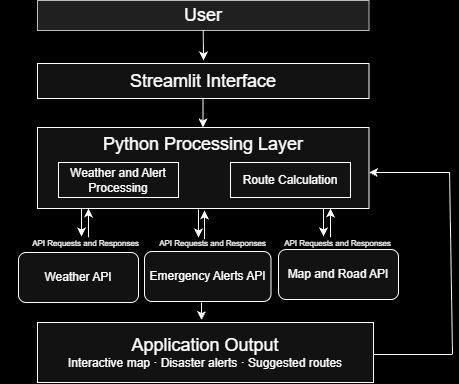

# CIS 3400 – Advanced Programming
## Project 2: Python Application Development

**Student Name:** Sudip Amgain  
**Project Title:** Know Your Way
**Course:** CIS 3400 – Advanced Programming  
**Final Presentation:** December 8, 2026

---
## 1. Project Overview

**Application Name:** Know Your Way

**Project Option:** Database-Enabled Application

### Problem Statement

Natural disasters such as floods, hurricanes, and severe storms can create dangerous situations for people, especially when they do not have access to timely, location-specific information. People may not know whether their area is affected by an active weather warning or where they can go to reach a safer location. This web app aims to address this problem by combining weather information, official emergency alerts, and interactive maps into one application. It will help users understand potential risks in their area and explore possible evacuation routes when necessary.

### Intended Users

The application is intended for individuals living in or traveling through areas that may be affected by natural disasters. It may be particularly useful for people who want to monitor weather-related risks, identify affected areas, and find possible routes to safer destinations.

### Unique Features

- Combines weather information and official emergency alerts with an interactive map.
- Provides location-based disaster advisories to help users understand potential risks in their area.
- Allows users to select a destination, such as an emergency shelter or another safer location.
- Uses Python graph algorithms to calculate and display possible evacuation routes.

Unlike a basic weather application, Know Your Way aims to connect disaster information with location-based route planning in a single interface.

---

## 2. Application Features

The initial version of this app will include the following features:

- **Feature 1: Interactive Map** – Display a map using an external map service. Users will be able to search for or select a geographical location.

- **Feature 2: Disaster Alerts and Advisories** – Retrieve weather information and official emergency alerts through external APIs. Display relevant warnings for hazards such as flooding, severe storms, and hurricanes.

- **Feature 3: Location-Based Risk Information** – Allow users to check the current alerts and weather conditions associated with a selected location.

- **Feature 4: Evacuation Route Planning** – Allow users to select a destination and calculate a possible route using Python graph algorithms. Where available, road restrictions and closures will be considered.

Users will interact with the application through a Streamlit dashboard. They will select a location, view relevant disaster information, and optionally choose a destination to explore possible evacuation routes.

The initial implementation will prioritize a limited geographical area and a small set of disaster types to keep the project manageable.

---

## 3. Technologies Used

The following technologies and libraries are planned for development:

| Technology | Purpose |
|---|---|
| Python | Main programming language and application logic |
| Streamlit | Building the interactive web dashboard |
| Pandas | Processing and organizing weather and alert data |
| Requests | Retrieving information from external APIs |
| NetworkX | Representing road networks as graphs and calculating possible routes |
| Folium / Streamlit-Folium | Displaying interactive maps and routes |
| External APIs | Retrieving map information, weather conditions, and official emergency alerts |
| SQLite (optional) | Storing selected locations or historical alert information if needed |

*The final technology list may change depending on API availability and implementation requirements.*

---

## 4. Data, Model, and API Plan

This app will primarily rely on external APIs rather than training a machine learning model.

### Planned Data Sources

1. **Weather API:** Retrieve current weather conditions and forecasts for selected locations. This information will help users monitor conditions associated with potential hazards.

2. **Official Emergency Alerts API:** Retrieve active warnings and advisories issued by emergency management authorities. These alerts will be used to identify areas affected by severe weather and other reported hazards.

3. **Map and Location Data:** Use an external mapping service to display geographical locations, identify destinations, and obtain road network information where available.

### Data Processing and Route Planning

Python will process the information retrieved from these APIs and organize it according to the selected location. NetworkX will be used to represent available roads as a graph, where intersections are nodes and roads are edges.

A shortest-path algorithm, such as Dijkstra's algorithm, will be used to calculate possible routes between a user's starting location and selected destination. If reliable road closure information is available, affected roads may be excluded from route calculations.

The application will prioritize official emergency alerts over general weather-based indications. It will not independently predict disasters or guarantee that a calculated route is safe.

---

## 5. Preliminary Application Architecture

The proposed architecture describes how information will move through the application.

**Planned Data Flow:**

1. User selects a location and destination through the Streamlit dashboard.
2. The application retrieves weather, emergency alert, and map information through external APIs.
3. Python processes the retrieved information and identifies relevant alerts for the selected location.
4. NetworkX processes the road network and calculates a possible evacuation route when requested.
5. The application displays the map, alerts, weather information, and suggested route to the user.

### Architecture Diagram



---

## 6. Preliminary Project Structure

The following is the proposed folder structure. It may change during development.

```text
Know Your Way Flow/
│
├── app.py                  # Main Streamlit application
│
├── modules/
│   ├── weather.py          # Weather API integration
│   ├── alerts.py           # Emergency alert retrieval
│   ├── maps.py             # Map visualization and location handling
│   └── routing.py          # Graph construction and route calculations
│
├── data/
│   └── sample_data.csv     # Sample data for development and testing
│
├── docs/
│   └── architecture.png    # Application architecture diagram
│
├── requirements.txt        # Project dependencies
├── .gitignore              # Files excluded from Git
└── README.md               # Project documentation
```

---

## 7. Anticipated Challenges

**Challenge 1: External API Integration**

Different APIs may provide information in different formats. Handling API responses, missing data, rate limits, and connection errors will require additional processing and error handling.

**Challenge 2: Road Network and Route Calculation**

Obtaining usable road network data and representing it as a graph may be challenging. The application will also need to account for road closures when reliable information is available.

**Challenge 3: Location-Based Alerts**

Matching emergency alerts to a user's selected location may require geographical processing because alerts can cover entire counties, regions, or specific geographical boundaries.

**Challenge 4: Accuracy and Reliability**

Weather information and emergency alerts may change frequently. The application must clearly distinguish official warnings from general weather information and avoid presenting calculated routes as guaranteed safe evacuation paths.

---

## 8. AI-Assisted Development Disclosure

**AI Tools Used:** ChatGPT

### How AI Will Be Used

AI assistance may be used during project planning, understanding external APIs, developing Python functions, debugging errors, and improving project documentation.

### Student Contributions

I will be responsible for designing the application, selecting and integrating the APIs, implementing the Python processing and routing algorithms, developing the Streamlit interface, and testing the application. I will review and modify AI-assisted code to ensure that I understand how the application works.

**Student statement:** I will review, test, and be able to explain the code and technologies used in my application, including code developed with AI assistance.

---

## 9. Project Links

**Deployed Application:** To be added after deployment.

---

### Development Timeline

- **Deliverable 1 – November 16:** Complete project proposal, planned features, technologies, architecture diagram, and preliminary project structure.
- **Deliverable 2 – November 23:** Update the README with implementation progress and initial testing.
- **Final Deliverable – December 8:** Complete application development, testing, documentation, screenshots, and final project presentation.